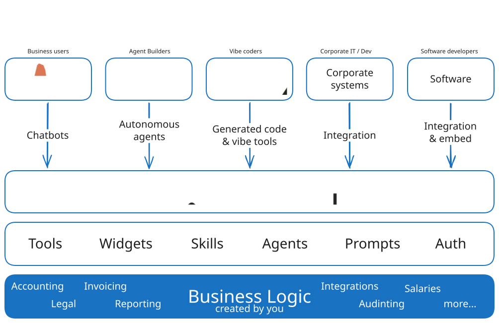
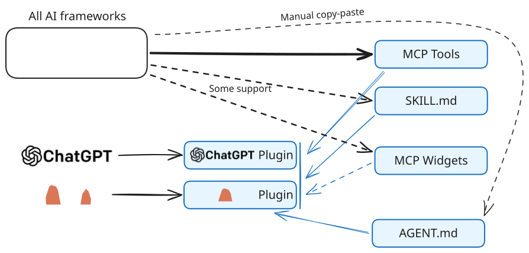
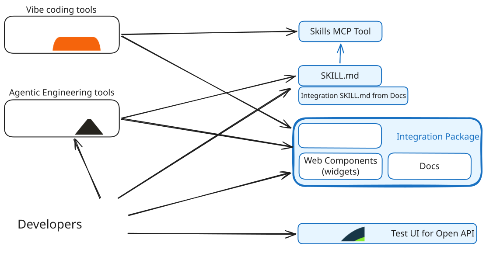

<!--
  GENERATED FILE — DO NOT EDIT DIRECTLY.
  Source: quartal-vault/Products/Plugins.md in the quartal docs repository.
  Regenerate with: pnpm export:plugin-readme (in the docs repository root)
-->


Quartal **Plugins** are packaged business functionality for **AI agents**: chatbots, autonomous agents and vibe-coding tools. The packaging is done in a way that more **traditional software** — SaaS products, internal corporate systems and automations — can use the same plugins too. The functionality is packaged as Tools (services), Widgets (UI), Agent Skills, Agents and Prompts.


You create a Quartal **Plugins** package once, containing the business logic for one business domain. You publish it as a plain web site, and people inside or outside your organization use that logic from chatbots, agents, vibe-coding tools, integrations and other software over the Model Context Protocol ([MCP](https://modelcontextprotocol.io/)), [OpenAPI](https://www.openapis.org/) (REST), [Agent Skills](https://agentskills.io/) and the [Agent Plugins](https://agent-plugins.org/) package format.

This page is a short overview. The full documentation — guides, reference and deployment — lives at **[plugin.quartal.com](https://plugin.quartal.com/)**.

> [!NOTE]
> **Release 1.0**
> This is the first production release of Quartal **Plugins**. The generation of a ready-to-install **Claude plugin** and **ChatGPT plugin** from your plugin project is not part of the 1.0 release: it is planned for the 1.1 release before 10.11.2026. Until then, connect Claude, ChatGPT and other clients to the plugin's MCP server and skills directly.

## Getting started
Requirements: Node.js 22+. We recommend [MCPJam](https://www.mcpjam.com/) for local testing, especially for widgets.

```bash
pnpm create @quartal/plugin
```

Alternatively, fork the template repository at [quartal-hub/plugin-template](https://github.com/quartal-hub/plugin-template). Then:

```bash
pnpm install
pnpm dev
```

Your plugin is an [Astro](https://astro.build) project running on `http://localhost:4321`, serving:

| URL                     | What                                                                       |
| ----------------------- | -------------------------------------------------------------------------- |
| `/`                     | Documentation site for your plugin (tools, widgets, skills, API testers)   |
| `/mcp`                  | The MCP server — connect any MCP client here                               |
| `/api/<class>/…`        | The generated OpenAPI / REST operations                                    |
| `/plugin.json`          | The Agent Plugins manifest (`/plugin.zip` is the installable package)      |
| `/widgets/<toolId>`     | Your widget pages                                                          |
| `/skills/catalog.json`  | The Agent Skills catalog                                                   |

Add a tool as a class in `src/tools/`, a widget as a page in `src/pages/widgets/` and a skill as a folder with a `SKILL.md` under `skills/`. Point [MCPJam](https://www.mcpjam.com/) (or Claude, or any MCP client) at `http://localhost:4321/mcp` and try your tools live.

Read the full guide: [Getting started](https://plugin.quartal.com/docs/getting-started) · [Creating tools](https://plugin.quartal.com/docs/tools/creating-tools) · [MCP Apps widgets](https://plugin.quartal.com/docs/widgets/mcp-apps-widgets) · [Agent Skills](https://plugin.quartal.com/docs/skills/agent-skills) · [HTTP endpoints](https://plugin.quartal.com/docs/reference/http-endpoints).

## Everything the AI agents need in one package
For example, if you create a plugin for integrating with an invoicing SaaS software that you provide, you might build:

- A couple of **Tools**:
	- One for creating an invoice
	- Another for listing all invoices with their status
- A **Skill** that explains how invoices should be created with all the regulatory requirements and how they will be sent, e.g. if they need an approval (for security) in your own UI
	- The Agent Skills standard is defined at https://agentskills.io/ and supported by most advanced AI tools
- A **Widget** for displaying the invoice as it would be shown as a PDF / print-out
- A couple of **Agents**
	- One that creates an invoice based on text or voice input in **interactive chat**
	- Another as an **autonomous agent** that monitors invoices and sends a report for those that have not been paid by the due date
- A **Prompt** that asks the user in interactive chat the minimum questions for creating a new invoice, instead of the user writing the initial text without any guidance.

We make creating these artifacts very easy:
- A **Tool** is just a **TypeScript function**: we automatically create the **Model Context Protocol (MCP)** server and wire the function as an **MCP Tool** — and as a REST operation with an OpenAPI description. See [Creating tools](https://plugin.quartal.com/docs/tools/creating-tools).
- A **Widget** is just a page in your favourite framework: **Vue, React, Svelte** etc. See [MCP Apps widgets](https://plugin.quartal.com/docs/widgets/mcp-apps-widgets).
- An **Agent** is just a markdown or JSON file. See [Agents](https://plugin.quartal.com/docs/more/agents).
- A **Skill** is just a folder with markdown files and other assets. See [Agent Skills](https://plugin.quartal.com/docs/skills/agent-skills).
- A **Prompt** is a very simple TypeScript function whose input parameters are text and which returns the instruction text to the agent. See [Prompts](https://plugin.quartal.com/docs/more/prompts).

In the picture below, all the blue components are generated by the Quartal **Plugins** infra from your business logic and code, so you do not need to worry about them:


## MCP Apps widgets: add UI to your tools
You can easily add a custom user interface to any of your tools. This has the following benefits:
- The tool results and further interaction UI are rendered exactly as you specify, not something that the model vibes on-the-fly (no hallucinations).
- The user saves a lot of tokens: tokens are not used for UI rendering.
- Widget UI renders many times faster than UI streamed from the model on-the-fly.

The [MCP Apps](https://modelcontextprotocol.io/extensions/apps/overview) standard is supported by the state-of-the-art chatbots, namely Anthropic Claude, OpenAI ChatGPT and M365 Copilot. Other chat clients not supporting widgets fall back to rendering UI by the AI model.

Quartal **Plugins** is based on Astro, so you can use basically any of your favourite UI frameworks such as [React, Vue, Svelte, plain JavaScript and more](https://docs.astro.build/en/guides/framework-components/). The starter kit scaffolds a widget in Vue, React or plain JavaScript; the [plugin template repository](https://github.com/quartal-hub/plugin-template) shows a Vue example. See [MCP Apps widgets](https://plugin.quartal.com/docs/widgets/mcp-apps-widgets).

## ... plus everything for software developers from the same source
MCP tools are great for AI agents, but when you are creating an app or integration — either "vibe coded" or by professional developers — you really want to connect to a real API. For this, we automatically create an [**OpenAPI**](https://www.openapis.org/)-compatible REST API with full documentation for developers. The same **UI widgets** are also available as a [Web Component](https://developer.mozilla.org/en-US/docs/Web/API/Web_components) (`<qrtl-widget>`, served by every plugin at `/widgets.js`) and as React and Vue components, so they can be embedded in any web UI — see [Embedding widgets](https://plugin.quartal.com/docs/widgets/embedding-widgets).

We generate documentation about all this as:
- A docs site for human developers, served by the plugin itself at `/`
- Swagger UI and Redoc for testing and reading the REST API
- A tool and widget tester for calling the tools over MCP and previewing their widgets
- Embedding instructions per widget (`/widgets/<toolId>/embed.md`) with ready-made prompts for coding agents such as Claude Code, Cursor or Lovable

## Security and authentication
You may provide your plugin as anonymous if your tools do not require any authentication, but often you need to authenticate the user to connect to external systems. For this we provide standard OAuth2 authentication that is wired through:
- MCP tools (with automatic login discovery in MCP clients such as Claude)
- The OpenAPI / REST operations
- The embedded web component (the page supplies the token)
- The test UIs on the docs site: Swagger and the tool tester

We provide out-of-the-box authentication with Quartal **IAM** (`auth: "quartal-hub"`, one line of configuration), but you may also use any OAuth 2.1 / OIDC compatible authentication server as specified in the MCP spec (`auth: "custom"`). OAuth2 authentication is still marked experimental in 1.0: its configuration may change in minor releases. See [Authentication](https://plugin.quartal.com/docs/auth/authentication).

Note that Skills, Agents, widget pages and documentation are always served anonymously: place any confidential data inside Tools instead of embedding it into Skills or Agents. This is also generally the best practice.

## Deploy your plugin
When you have tested your plugin, you deploy it as a [server-rendered Astro web site to any modern hosting platform](https://docs.astro.build/en/guides/deploy/). From there anyone can use the plugin. Vercel, Railway and Cloudflare Workers are documented step by step: see [Deploying](https://plugin.quartal.com/docs/deploying/deploying).

### Publish in Quartal **Hub**
Quartal **Hub** is a registry for plugins where users discover plugins, test them with authentication, and manage and authorize them for the agents and users of their organization. Registering a plugin in Quartal **Hub** is currently available for partners working directly with us.

## Open source and zero lock-in
Quartal **Plugins** is an open source project with the MIT license. It is based on [Astro](https://astro.build) (also MIT) and can be [deployed to any modern hosting platform](https://docs.astro.build/en/guides/deploy/). UI widgets can be created with any of your favourite UI frameworks such as [React, Vue, Svelte, plain JavaScript and more](https://docs.astro.build/en/guides/framework-components/).

## Capabilities
We make it as easy as possible to provide a set of business functionality in one simple package:

- **Tools:** reusable code that can be executed by agents and software via:
    - **MCP tools** by AI agents
    - **OpenAPI / REST operations** by agents, vibe-coded software and other services
- **Widgets** as defined by the MCP Apps standard
    - User interfaces in interactive chat agents like Claude or ChatGPT
    - The same widgets embedded in any web page as a web component, or as React and Vue components
- **Agent Skills** that guide AI agents on how to use these tools and other business logic
- **Agents** as defined by [Claude plugin agents](https://code.claude.com/docs/en/plugins-reference#agents)
	- Served from the plugin and included in the Agent Plugins package; support for other platforms is planned (PRs are welcome)
- **Prompts** as defined in MCP
- **An Agent Plugins package** (`/plugin.json`, `/mcp.json`, `/plugin.zip`) following the cross-vendor [Agent Plugins 1.0](https://agent-plugins.org/) standard

Everything above is documented by the plugin's own docs site, and the plugin serves all files and folders in its `/public` folder the way a public folder works in Vue apps. The complete list is in the [HTTP endpoints](https://plugin.quartal.com/docs/reference/http-endpoints) reference.
## Contributing
See [CONTRIBUTING.md](https://github.com/quartal-hub/plugin/blob/main/CONTRIBUTING.md) for instructions if you wish to contribute to our project.

As we are early in the release cycle we only take issues and bug reports from partners that work directly with us. We expect this to change by the end of 2026.
